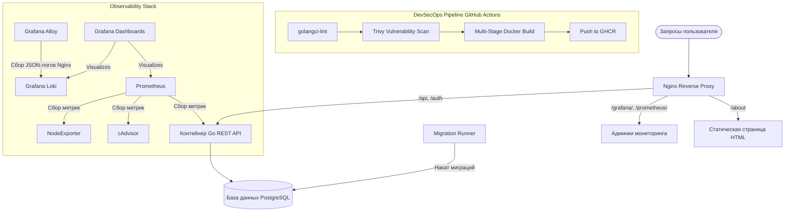

# Go-Infra-Project 

Контейнеризованная инфраструктура для Go-микросервиса. Проект демонстрирует практическое применение Docker-оркестрации, автоматизации CI/CD (DevSecOps) и развертывания Observability-стека на удаленном VPS-сервере.

---

## Архитектура и схема взаимодействия

Вся инфраструктура полностью контейнеризирована и оркеструется через **Docker Compose** с изоляцией сетей и контролем последовательности запуска сервисов.



### Технологический стек:
*   **Backend:** Go (Golang) REST API (эндпоинты `/api` и `/auth`) + HTML-страница визуализации по эндпоинту `/about`.
*   **Web Server / Reverse Proxy:** Nginx (с проксированием сервисов и кастомным JSON-логированием под Loki).
*   **Database:** PostgreSQL + контейнер `golang-migrate` для наката схемы данных.
*   **CI/CD & Безопасность (DevSecOps):** GitHub Actions, `golangci-lint`, Trivy Security Scanner, GHCR.
*   **Observability (Метрики и Логи):** Prometheus, Grafana, Grafana Loki, Grafana Alloy, cAdvisor, Node Exporter. *(Связка Alertmanager / Telegram-bot временно закомментирована).*

---

## Реализованные Infrastructure & Security Best Practices

### 1. Безопасная контейнеризация (Dockerfile)
*   **Multi-Stage Build:** Сборка разделена на этапы `builder` (тяжелый Go-образ) и `runner` (финальный образ), что минимизирует размер артефакта и атак-поверхность.
*   **Non-Root User:** Приложение внутри контейнера выполняется под учетной записью пользователя без root-привилегий.

### 2. Надежность слоя данных и управление секретами
*   **Автоматические миграции:** Схема БД накатывается детерминированно через выделенный контейнер-мигратор (SQL-файлы `up`/`down`).
*   **Health Checks:** Контейнер с Go-приложением заблокирован на запуск до тех пор, пока PostgreSQL не пройдет нативный health-check внутри Docker Compose.
*   **12-Factor App & Безопасность секретов:** Из проекта удалена библиотека конфигурации `viper`. Все секреты передаются в приложение строго через переменные окружения. 
*   **Изоляция конфигурации хоста:** Файл окружения `.env` полностью изолирован от git-репозитория и вынесен в выделенную директорию на сервере (`~/.Go-Infra-Project`), что исключает случайную утечку чувствительных данных. Выполнение пайплайна деплоя (`deploy.yml`) жестко валидирует наличие этого файла перед стартом.

### 3. Настройка Nginx и Парсинг логов (Observability)
*   **JSON Logging:** В конфигурации Nginx настроен кастомный формат логирования в формате JSON. Это позволяет **Grafana Loki** бесшовно парсить поля логов без сложных регулярных выражений.
*   **Reverse Proxying:** Nginx настроен как единая точка входа трафика. Запросы на эндпоинты бэкенда (`/api`, `/auth`), статический HTML (`/about`) и панели мониторинга маршрутизируются через `proxy_pass`. Панели доступны по путям `/prometheus/` и `/grafana/` соответственно.
*   *Важное архитектурное примечание:* Открытие панелей Prometheus и Grafana во внешний мир через Nginx на публичном IP-адресе реализовано исключительно в целях удобства демонстрации учебного стенда. В реальном production-контуре данные админки изолируются внутри приватной сети и доступны только через VPN/Bastion хост.

---

## DevSecOps: GitHub Actions CI/CD Пайплайн

Автоматизированный пайплайн запускается на каждый push/PR в ветку `main` и реализует концепцию Shift-Left Security:

1.  **Качество кода:** Проверка линтерами через `golangci-lint`.
2.  **Сканирование безопасности (SAST):** Сканер `Trivy` проверяет репозиторий и слои образов на наличие известных уязвимостей (CVE) и миссконфигураций.
3.  **Сборка артефакта:** Компиляция Go-бинарника в изолированном Docker-окружении.
4.  **Реестр пакетов:** Пуш готового проверенного образа в публичный репозиторий **GitHub Container Registry (GHCR)** с тегированием по уникальному SHA-хэшу коммита.
5.  **Безопасный CD (Деплой по кнопке):** Деплой запускается вручную "по кнопке" с указанием конкретного хэша коммита. **Все чувствительные данные для подключения к удаленному VPS (SSH-ключи, доступы) изолированы внутри зашифрованных GitHub Actions Secrets** и не присутствуют в открытом коде. Запуск пайплайна деплоя доступен только владельцу репозитория, при этом сам стенд полностью автономен и может быть развернут на любом хосте после клонирования и настройки локального `.env`.

---

## Порядок развертывания на сервере

### Системные требования
*   Docker (v20.10+)
*   Docker Compose (v2.0+)

### 1. Подготовка окружения и секретов на VPS
Перед запуском стека необходимо создать файл окружения .env в корне проекта рядом с конфигом docker compose:

```bash
mkdir -p ~/.Go-Infra-Project
nano ~/.Go-Infra-Project/.env
```

Шаблон конфигурационного файла `.env`:
```env
# Server data
SERVER_IP=YOUR_SERVER_PUBLIC_IP

# App data
PORT=8000
DB_USERNAME=dbuser
DB_PASSWORD=changeme_app_pass
DB_HOST=postgres
DB_PORT=5432
DB_NAME=dbname
DB_SSLMODE=disable

# PostgreSQL data
POSTGRES_USER=dbuser
POSTGRES_DB=dbname
POSTGRES_PASSWORD=changeme_app_pass

# Grafana data
GF_SECURITY_ADMIN_USER=admin
GF_SECURITY_ADMIN_PASSWORD=changeme_grafana_pass
```

### 2. Клонирование проекта
```bash
git clone https://github.com/teIImewhy/Go-Infra-Project
cd Go-Infra-Project
```

### 3. Запуск инфраструктуры
Команда соберет Go-приложение, подтянет конфигурацию секретов из окружения хоста и поднимет весь стек в фоновом режиме:
```bash
docker compose up -d --build
```

---

## Доступ к интерфейсам демонстрационного стенда

После успешного запуска все веб-интерфейсы и эндпоинты доступны по публичному IP-адресу вашего сервера (`YOUR_SERVER_PUBLIC_IP`):

*   **Go REST API (Маршрутизация эндпоинтов):** `http://YOUR_SERVER_PUBLIC_IP:80/api` или `/auth`
*   **Визуальная страница проекта (HTML-about):** `http://YOUR_SERVER_PUBLIC_IP:80/about`
*   **Панель Grafana (Метрики + Loki логи):** `http://YOUR_SERVER_PUBLIC_IP:80/grafana/`
*   **Панель Prometheus:** `http://YOUR_SERVER_PUBLIC_IP:80/prometheus/`
